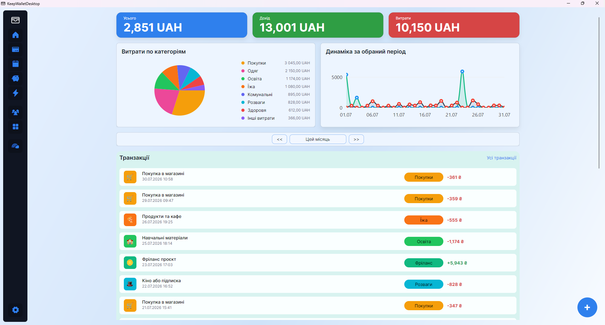
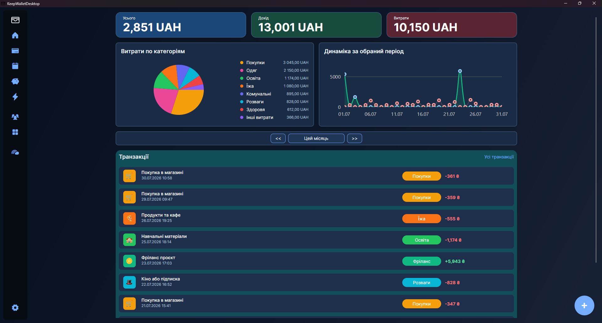

# KeepWallet

KeepWallet is an app for managing personal and shared finances in one place. It helps you track balances, record income and expenses, plan upcoming payments, build savings, and understand where your money goes.

It is designed for everyday money management: from quickly logging purchases to keeping an eye on shared accounts, savings goals, and reports for any selected period.

## Features

- **Balance overview** — see your total balance, income, expenses, transaction trends, and spending by category.
- **Bank accounts** — manage multiple accounts with different currencies, balances, and purposes.
- **Transactions** — add income and expenses with a date, amount, category, description, and account.
- **Categories** — use ready-made income and expense categories or customize them to match your habits.
- **Scheduled payments** — track one-time and recurring payments, paid status, overdue items, and upcoming expenses.
- **Savings** — create financial goals, monitor progress, add or withdraw money, and keep a wishlist.
- **Groups** — share access to accounts, savings, transactions, and payments with family members or a team.
- **Reports** — analyze income, expenses, balances, categories, and trends for a selected period.
- **Report export** — save financial reports in a convenient format for viewing or sharing.
- **Light and dark themes** — use the app comfortably during the day or at night.
- **Ukrainian and English interface** — switch the app language in settings.

## App Preview

### Interface Overview

## Everyday Use

1. Open the app and instantly see your current financial picture.
2. Add income or expenses in a few seconds.
3. Check which payments are coming up soon.
4. See how much you have already saved toward a goal.
5. Compare spending by category for a week, month, or custom period.
6. Share selected financial data with group members.

## Who It Is For

KeepWallet is useful for anyone who wants to:

- control personal spending;
- manage several accounts;
- plan recurring payments;
- save for specific goals;
- analyze expenses by category;
- maintain a shared budget with other people.